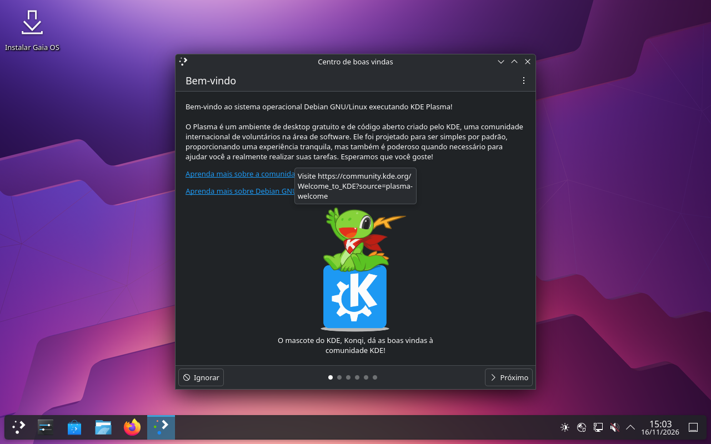

# Gaia OS Ivy Bridge Edition

Sistema Debian para o desktop do Francisco: **Intel Core i7-3770**, placa **B75**, **16 GiB** DDR3, **Intel HD Graphics 4000**, rede **Realtek RTL8111/8168**, SSD SATA de 256 GB, boot **UEFI**.

A edição Westmere (Gateway NV55C, Debian 12, Plasma 5.27) continua documentada no [dossiê](docs/DOSSIE_SISTEMA_GAIAOS.md). Os escudos daquela edição vêm junto. O que era ajuste de notebook de 6 GiB foi refeito para este desktop.

## Base

**Debian 13 Trixie** (estável em novembro de 2026, ponto 13.7 em setembro de 2026), não o Bookworm.

- Plasma **6.3.6**, SDDM, sessão **Wayland** (`plasma`) e fallback X11 (`plasmax11`), tema **Breeze Dark**
- Kernel **6.12 LTS** pelo metapacote `linux-image-amd64` (a revisão exata da imagem construída fica em `dist/VERSIONS.txt` e em `/etc/gaiaos/build-versions.txt`)
- `intel-microcode` e `firmware-realtek` (arquivo `rtl_nic/rtl8168h-2.fw`)
- Segurança Debian todo dia e `gaia-update` toda semana

Trixie é a estável atual, com suporte de segurança até 2028 e LTS até 2030. Sid teria pacotes mais novos e também quebras. Backports fica ligado com prioridade 100: dá para pedir um pacote novo, e ele não entra sozinho no meio de um `full-upgrade`.

A imagem de referência construída em 16/11/2026 levou o kernel `6.12.117+deb13-amd64`, Plasma `6.3.6`, SDDM `0.21.0`, Calamares `3.3.14`, Firefox ESR `153.7.0esr` e `intel-microcode` `3.20251111.1`. Um build posterior acompanha o arquivo do Trixie naquele dia; a lista exata fica em `/etc/gaiaos/build-versions.txt`.



## O que a ISO traz

KDE que a edição Westmere já usava, nos nomes do Plasma 6: Dolphin, Konsole, Kate, Spectacle, Discover, Monitor do Sistema, rede, áudio, cofres, discos, navegador do Plasma, PowerDevil, Bluetooth (o programa; a máquina não tem rádio), Thunderbolt (o programa; a B75 não tem a porta), KScreen, portal do KDE, Firefox ESR em pt-BR.

Sessão live: usuário `gaia`, senha `gaia`, teclado ABNT2, fuso `America/Sao_Paulo`. O instalador é o Calamares. O layout sugerido é EFI de 600 MiB, `/boot` de 1 GiB e raiz ext4 com TRIM.

Como gravar o pendrive e instalar: [docs/INSTALACAO_IVYBRIDGE.md](docs/INSTALACAO_IVYBRIDGE.md).

## Atualizar sem outro pendrive

| Peça | Como |
| :--- | :--- |
| Segurança Debian | `unattended-upgrades`, todo dia |
| Kernel, apps e o resto do Trixie | `gaia-update.timer`, toda semana (`apt full-upgrade`) |
| Ferramentas deste repositório | o mesmo timer baixa `gaiaos-core_*_amd64.deb` da última release, se a versão for maior |
| Configurações | `gaia-snapshot create` antes de cada atualização; `gaia-snapshot rollback` volta os arquivos de `/etc` |
| Kernel anterior | menu do GRUB. O atualizador não remove o kernel antigo |

Na hora: `sudo gaia-update`.

## Construir a ISO

```bash
./scripts/build-iso.sh
```

Saída: `dist/gaiaos-ivybridge-1.0-amd64.iso` e o `.sha256`. O `live-build` usado é o do Trixie (`1:20250505`); o script instala esse pacote se a máquina tiver o live-build velho do Ubuntu.

O workflow [`.github/workflows/build-iso.yml`](.github/workflows/build-iso.yml) repete o build em `ubuntu-24.04` quando alguém envia uma tag `ivybridge-v*` ou dispara o workflow à mão. Na tag, ele publica uma GitHub Release. Se a ISO passar de 2 GiB, os pedaços e o modo de juntar vão junto.

Provar o boot UEFI na máquina de build:

```bash
./scripts/test-qemu.sh
```

## Escudos que vieram da edição Westmere

| Prioridade | O quê | Onde |
| :--- | :--- | :--- |
| CVE-2026-98432 | Drop de opções IPv4 e de MPTCP no netfilter raw, `net.mptcp.enabled=0` | `security/` |
| Node2Shell e os CVEs de TLS/DNS | `gaia-node-shield.cjs` via `NODE_OPTIONS` | `security/node/` |
| PHP2Shell | ini preventiva, mesmo sem PHP instalado | `security/php/` |

O Node do Trixie é o 20.x corrigido pela segurança Debian. A ISO não adiciona o repositório NodeSource. O piso `22.23.4` da estação Westmere continua valendo só para aquele runtime do Codex, se ele existir no home.

## Ferramentas

| Comando | Função |
| :--- | :--- |
| `gaia-sec-verify` | Atalho para `tests/verify-security.sh` no sistema instalado |
| `gaia-update` | Snapshot, APT e pacote `gaiaos-core` |
| `gaia-snapshot` | Snapshot e rollback de `/etc` |
| `gaia-pkg` | `.deb` local em `/var/local/gaia-repo` (codinome `ivybridge`) |
| `gaia-guardian-ui` | Painel PyQt6 do daemon em C |
| `gaia-sec-apply` | Reaplica os escudos |
| `agy --yolo` | Atalho do Antigravity CLI |

O pacote Debian é o `gaiaos-core`. `scripts/build-gaia-deb.sh` gera o `.deb` em `dist/`.

## Hardware

Detalhe em [gaia-hardware-profile.md](gaia-hardware-profile.md). Módulos que importam: `i915`, `r8169`, `snd_hda_intel`, `ahci`, `xhci_hcd`, `ehci_pci`, `i2c_i801`.

Não há Wi-Fi nem Bluetooth. O `ModemManager` fica mascarado. O `fwupd` não fica mascarado.

A integração Muse Wonder em `integrations/muse-wonder/` continua no repositório e dentro de `/usr/share/gaiaos`, desligada. Ela ainda aponta para o usuário `francisco` e para o projeto Vertex da edição anterior; ligue só se for usar.
